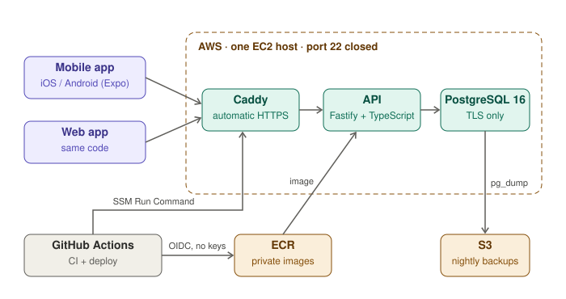

# DevOps & Cloud portfolio — Jaime Castillo Araujo

**Three projects covering the path from a commit to a service running in production, staying up under
failure, and recovering with evidence.** Built as eight self-contained components, each with its own tests,
docs, diagrams and CI pipeline — all eight run on GitHub Actions and pass.

`Terraform` `Kubernetes` `AWS` `GitHub Actions` `Docker` `Prometheus` `Argo CD` `Python`

---

## 1 · [Delivery platform](showcase/1-delivery-platform.md)

One service followed from a commit to an on-call page. A pipeline that refuses to ship a vulnerable image,
a multi-AZ AWS platform deployed without stored cloud keys, GitOps promotion by pull request, and error-budget
SLO alerting with runbooks.

*The Trivy gate failed its first real run on four fixable HIGH CVEs in the base image — the fix was removing
the package installers and flattening the runtime so the scanned image is exactly the image that runs.*

`GitHub Actions` `Docker` `Trivy` `cosign` `Terraform` `ECS Fargate` `IAM OIDC` `Kustomize` `Argo CD` `Prometheus`
→ components [01](projects/01-secure-cicd-pipeline) · [02](projects/02-aws-terraform-platform) · [03](projects/03-k8s-gitops) · [04](projects/04-observability-slo)

## 2 · [Reliability and recovery](showcase/2-reliability-and-recovery.md)

Three answers to the same question: what happens when it breaks? A gateway that keeps serving through a
provider outage, a lab that states reliability as numbers and rehearses failure against them, and an autopilot
that drives recovery and drafts the postmortem from the timeline it observed.

*In a simulated total outage of the primary provider, all 180 requests still succeeded through the fallback.
A 5% error rate pages after 18 minutes, having spent 2.2% of the monthly error budget — and that delay is
defensible, not accidental.*

`Python` `Prometheus` `Alertmanager` `PostgreSQL` `chaos experiments` `circuit breakers` `SLOs`
→ components [05](projects/05-ai-reliability-platform) · [07](projects/07-sre-reliability-lab) · [08](projects/08-disaster-recovery-autopilot)

## 3 · [Developer platform](showcase/3-developer-platform.md)

A paved road: one command produces a production-shaped service that already satisfies every guardrail, and the
same rules audit any existing repository by rule ID.

*Every policy rule carries a mutation test that breaks one thing and expects the checker to name that rule.*

`Python` `Jinja2` `Terraform` `Kubernetes` `policy-as-code` `OIDC`
→ component [06](projects/06-self-service-platform)

---

## 4 · Applied: Juega App (private product, deployed)

The same practices on a real product I run: **Juega App**, a free iOS, Android and web app that organizes
pickup football matches: sign-ups, teams balanced from past ratings and results, teammate ratings, goals and
own goals, and monthly and yearly stats that players can share as cards. It is **live and running** on an AWS EC2
instance that I created and configured myself, with Terraform adapted from component 02, and every push to `dev`
is deployed to it by GitHub Actions. `dev` is the branch and environment that is deployed today; `main` is the production branch, and CI runs on both. The source is in a private repository because the app is
headed to the App Store and Google Play; the architecture and the decisions are public here.



<sub>Diagram source: [`4-pickup-football.mmd`](showcase/schematics/4-pickup-football.mmd)</sub>

| Area | What it uses |
|---|---|
| CI (adapted from [01](projects/01-secure-cicd-pipeline)) | Lint, typecheck, API and mobile tests (API against a real PostgreSQL), hadolint, gitleaks, Trivy gate on the image, SBOM, a production-stack smoke test |
| Infrastructure (adapted from [02](projects/02-aws-terraform-platform)) | Terraform: the VPC module with NAT and flow logs made optional, one EC2 host (`t3.micro`), ECR, S3, Parameter Store, CloudWatch alarms; provider lock files committed |
| Delivery | Deploy role trusts one branch of one repository, pinned to GitHub's immutable OIDC subject (repository ids, not just names); the image is pushed to ECR and started over SSM, no SSH, port 22 closed. The deploy job runs only after every other check passes and ends with an HTTPS smoke test |
| Observability and SLOs (from [04](projects/04-observability-slo)) | A request ID on every response and in error bodies, Prometheus-format `/metrics` by route (answered with 404 from outside by Caddy), two written SLOs (99.5% availability, 95% of requests under 250 ms) with the PromQL to measure them and an error-budget policy |
| Data safety (from [08](projects/08-disaster-recovery-autopilot)) | Database accepts encrypted connections only; each nightly backup is restored into a scratch database and checked when it is taken, and carries a SHA-256 and exact row counts; a backup of live data that fails its integrity checks is refused; `restore.sh` runs the drill before replacing anything |
| Reliability practice (from [07](projects/07-sre-reliability-lab)) | Two game days with hypotheses and measured results: crashes, a memory leak and spoofed addresses, then damaged backups and broken live data. Runbooks per alarm, written recovery targets and a postmortem template |
| Application security | Rotating refresh tokens with reuse detection, per-account login lockout, row locks so a roster never overfills |
| Fair teams | A pure function splits players by position, then spreads the strongest of each position so both teams end level on average strength. Strength comes from received ratings (this group first, then everywhere, recent matches weighted a little more) nudged by recent results. Measured over 400 simulated groups (not real matches yet): average gap between teams 0.19 points, against 1.27 without it. The randomizer is optional and admins can still change teams by hand |
| Sign-in with Google and Apple | The API checks the provider's signature, issuer, audience, expiry and nonce, and keeps only the provider's stable id. A provider login links to an existing account only when that account's email was confirmed, so registering someone's address first cannot take the account over. Accounts without a password confirm deletion with the provider |
| Privacy by design | Profile photos are small, stored in the database (so backups cover them) and visible only to people who share a group. Share cards are drawn on the phone and show only the player's own numbers; the predicted win chance used for balancing is never shown or returned |

*The cost decision: one server at about $13 a month instead of ECS, a load balancer and a NAT gateway at
$40–50+ before there are users. The image, settings and backups carry over unchanged when traffic
justifies moving to ECS and RDS, and the conditions for that move are written down in advance.*

`TypeScript` `Fastify` `PostgreSQL` `Expo` `Docker Compose` `Caddy` `Terraform` `AWS` `GitHub Actions` `SLOs`

**Proven** (CI green on `dev` on 2026-11-11): API lint, typecheck and 291 tests, mobile typecheck, lint and 169
tests, hadolint, gitleaks, the Trivy image gate, a production-stack smoke test, a database-encryption check, and
backup drills that refuse a damaged backup and broken live data. The Terraform has been applied to my AWS
account, the instance is up and serving, and the deploy job has run end to end: image build and SBOM, push to ECR, deploy over SSM through the
OIDC role, and an HTTPS smoke test against the running server that checks `/health`, the request ID header and
that `/metrics` is not public. Infrastructure workflow: `terraform fmt`, wiring check, `validate` for the bootstrap
and dev environments, TFLint pass, and a Checkov scan runs report-only.
**Not yet proven:** a verified nightly backup run on the server (the first is due 2026-11-12), a restore on the AWS server from its S3 copy, an alarm on a failed nightly backup, the load
test and failure drills repeated on the real server (they ran on a development PC), an external uptime probe and
burn-rate alerts (so an outage between deploys is noticed by a person, not an alert), an automated deploy
from `main` (the repository has a deploy job and Terraform environment only for `dev`), and the app on real iOS and Android devices. Sign in with Google and Apple is tested only against locally signed
test tokens, not the real providers. Source code is available on request for hiring processes.

What CI and the first real deploy caught, rather than me:
- A production check rejected 23.7% of valid random JWT secrets, so about one deploy in four would not have started.
  It passed on my machine only because my secret happened to qualify. The fix was a looser rule and a test over
  thousands of random secrets.
- The image scan found 10 fixable HIGH vulnerabilities, all inside the `npm` bundled with Node. The fix was removing
  the package managers from the final image, not suppressing the finding.
- When `main` first received the whole history, gitleaks flagged a made-up string in a test (a sample secret used to
  check that production accepts strong secrets). I added an ignore entry for that one finding, with the reason written
  next to it, instead of switching the scan off.
- The first `terraform apply` failed on two things a `validate` never sees: a `for_each` whose keys depended on the
  Elastic IP and so were unknown until apply, and an apostrophe AWS rejects in a security-group rule description.
- The first deploy was refused by the AWS role: GitHub sends the repository's numeric id in the OIDC subject, so the
  trust policy written from the repository name did not match. The role now trusts that immutable form, which a
  renamed or re-created repository cannot reuse.
- The backup drill compared a restored backup with the live database, which changes whenever anyone uses the app, so a
  backup that restored but held wrong data would have passed. It now compares against exact counts recorded when the
  backup was taken.

---

## About me

I'm **Jaime Castillo Araujo**, based in Managua, Nicaragua.

I'm a DevOps and cloud engineer, and I've worked as a **freelance DevOps and cloud consultant since 2023**. I came
to it through production support: **Tech Support Specialist at Ibex**, supporting a point-of-sale SaaS platform,
promoted from Level 1 to Level 2 after a year.

That background is where this portfolio comes from. Time on the receiving end of outages teaches you which alerts
are worth waking someone for, why a runbook matters more than a dashboard, and how much of an incident is
communication rather than terminal commands. These projects are the next step: building the delivery pipelines,
the infrastructure and the recovery tooling that decide whether a support queue is calm or on fire.

### What I'm looking for

Open to **remote roles across Latin America**, not limited to Nicaragua.

- Junior DevOps Engineer / DevOps Engineer
- Junior Cloud Engineer / AWS Engineer
- Junior Platform or Infrastructure Engineer
- Junior SRE, where the role is about reliability engineering rather than the pager alone

I'm early in the DevOps side of my career and direct about it: this repository is deliberately explicit about
what has actually been run versus what has only been written. I'd rather be hired on what I can defend.

### How this was built

I build this with Claude Code, Anthropic's AI coding tool, under strong human oversight. Claude is the working
tool; the decisions, the review and the control are mine. I decide what gets built and what each component has to
prove, review the changes, check the repositories, decide what to fix or move, and run and debug the results. I keep
a human hand on security and control throughout. The results in the tables below come from checks that actually
ran, in GitHub Actions or locally. Anything not yet run is listed under "Not proven anywhere yet".

### Contact

| | |
|---|---|
| Email | [castilloajosejaime@gmail.com](mailto:castilloajosejaime@gmail.com) |
| GitHub | [@Joxejaime](https://github.com/Joxejaime) |
| LinkedIn | [jaime-castillo-araujo](https://www.linkedin.com/in/jaime-castillo-araujo) |
| Location | Managua, Nicaragua · open to remote across LatAm |

---

## What is proven, and what is not

Nothing here is claimed unless it has been run. Each component README ends with its own
**Verification status** table.

| Component | Checks that have run | Where |
|---|---|---|
| [01](projects/01-secure-cicd-pipeline) Secure CI/CD | Lint, 15 unit tests, hadolint, gitleaks, image build, container smoke test, Trivy gate, SBOM, GHCR publish by digest, cosign keyless signature, provenance attestation | GitHub Actions |
| [02](projects/02-aws-terraform-platform) AWS platform | `fmt`, module wiring check, `init` + `validate` for bootstrap/dev/prod, TFLint, Checkov (21 findings triaged) | GitHub Actions |
| [03](projects/03-k8s-gitops) Kubernetes GitOps | `kustomize build`, strict kubeconform validation, policy checks on both overlays, 15 policy tests | GitHub Actions |
| [04](projects/04-observability-slo) Observability | Drift check, promtool config and rule checks, 8 alert-rule scenarios, amtool, compose validation; one real end-to-end alert run | GitHub Actions, local |
| [05](projects/05-ai-reliability-platform) AI reliability | 40 unit and end-to-end tests, image build and scan, Terraform checks; provider-outage drill | GitHub Actions, local |
| [06](projects/06-self-service-platform) Developer platform | 32 tests, scaffold → validate → generated-tests round trip, Terraform checks | GitHub Actions |
| [07](projects/07-sre-reliability-lab) SRE lab | Lint, SLO validation, 33 tests including live chaos experiments, promtool rule checks | GitHub Actions |
| [08](projects/08-disaster-recovery-autopilot) DR autopilot | Lint, playbook validation, 85 pytest tests against a real PostgreSQL 16 server, three recovery drills with their postmortem drafts committed | GitHub Actions, local |

### Running live in Juega App

[Juega App](#4--applied-juega-app-private-product-deployed) is a deployed product that reuses these components.
These pieces run today on the instance I created and configured, and the checks behind them pass in that product's
CI and deploy. That is evidence for the practices, not for the eight folders above, which are unchanged: Juega's
versions are adapted copies in a private repository, and its deployed environment is `dev`.

| Component | Used in Juega App | Not used there |
|---|---|---|
| [01](projects/01-secure-cicd-pipeline) Secure CI/CD | Same gate structure: hadolint, gitleaks, Trivy at HIGH/CRITICAL, SBOM, and a deploy job that waits for every other check. The "remove the package managers from the image" fix was reused after Trivy found 10 HIGH findings inside the bundled `npm` | cosign signing, provenance, publishing by digest |
| [02](projects/02-aws-terraform-platform) AWS platform | The VPC module (with NAT and flow logs made optional), the state bucket and OIDC provider bootstrap, the OIDC deploy role with no stored keys, TFLint and Checkov. **Applied to a real AWS account** and deployed through | The ECS service module, multi-AZ layout, production environment |
| [03](projects/03-k8s-gitops) Kubernetes GitOps | Nothing | Everything: Juega App runs on one host with Docker Compose |
| [04](projects/04-observability-slo) Observability | The SLO method: two written objectives, error-budget policy, request metrics by route, with the PromQL to measure them | The Prometheus, Alertmanager and Grafana stack; the PromQL has never run against a live Prometheus, so nothing alerts on burn rate |
| [05](projects/05-ai-reliability-platform) AI reliability | Nothing | Everything |
| [06](projects/06-self-service-platform) Developer platform | Nothing | Everything |
| [07](projects/07-sre-reliability-lab) SRE lab | The game-day method (hypothesis, injection, observation, verdict, follow-ups). Two game days run: crashes, memory runaway, spoofed addresses, load, then damaged backups and broken live data. One finding is live: a CloudWatch low-CPU-credits alarm on the instance | The chaos runner and simulator code; both game days ran on a development PC, not on AWS |
| [08](projects/08-disaster-recovery-autopilot) DR autopilot | The ideas, rewritten as shell scripts and **deployed on the instance** (first scheduled nightly run due 2026-11-12, so not yet verified live): restore every backup into a scratch database, verify checksum and row counts, refuse suspect data, a restore drill before any real restore; CI proves the refusals on every push. Also runbooks per alarm, RPO/RTO, a postmortem template | The `drpilot` service itself; a drill from the S3 copy on the server; no real incident has happened, so no postmortem has been written from one |

Live status of all eight pipelines:

[](https://github.com/Joxejaime/devops-portfolio/actions/workflows/01-secure-cicd.yml)
[](https://github.com/Joxejaime/devops-portfolio/actions/workflows/02-terraform.yml)
[](https://github.com/Joxejaime/devops-portfolio/actions/workflows/03-k8s-gitops.yml)
[](https://github.com/Joxejaime/devops-portfolio/actions/workflows/04-observability.yml)
[](https://github.com/Joxejaime/devops-portfolio/actions/workflows/05-ai-reliability-platform.yml)
[](https://github.com/Joxejaime/devops-portfolio/actions/workflows/06-self-service-platform.yml)
[](https://github.com/Joxejaime/devops-portfolio/actions/workflows/07-sre-reliability-lab.yml)
[](https://github.com/Joxejaime/devops-portfolio/actions/workflows/08-disaster-recovery-autopilot.yml)

### Measured: CI runs on `main`

| Pipeline | Runs | Passed | Typical duration |
|---|---|---|---|
| 01 Secure CI/CD | 3 | 2 | 1m 53s |
| 02 AWS platform (Terraform) | 3 | 3 | 35s |
| 03 Kubernetes GitOps | 3 | 3 | 24s |
| 04 Observability | 1 | 1 | 12s |
| 05 AI reliability | 3 | 3 | 1m 12s |
| 06 Developer platform | 3 | 3 | 21s |
| 07 SRE lab | 2 | 2 | 43s |
| 08 DR autopilot | 1 | 1 | 1m 16s |

Measured on 2026-10-26 from the GitHub Actions API: completed runs on `main`, duration from run start to last
update, typical = median of the passing runs. Pipelines only run when their own folder changes, so each has few
runs; the counts grow with every push. Nineteen runs, eighteen passed, and the one failure is in pipeline 01.

**Not proven anywhere yet in these eight components:** applying their own Terraform to a real AWS account, an Argo CD
sync on a real cluster, Grafana rendering the dashboard, the Docker Compose stacks, and `cosign verify` against the
published image. The Terraform patterns from 02 have been applied for real in [Juega App](#4--applied-juega-app-private-product-deployed),
a separate product, which is where the OIDC deploy and the backup practices were exercised on AWS.
[`projects/00-start-here/docs/PORTFOLIO-GUIDE.md`](projects/00-start-here/docs/PORTFOLIO-GUIDE.md) is the plan
for turning each of those into evidence.

[`ENGINEERING-NOTES.md`](projects/00-start-here/docs/ENGINEERING-NOTES.md) writes up three problems from
building this where the reasoning mattered more than the patch — a Docker layer model that was wrong, a
lint rule worth suppressing on purpose, and a hardening pass Dependabot nearly reverted twice.

---

## Repository layout

The eight folders under `projects/` are the engineering record — one per component, each self-contained.
`showcase/` is the reading view that groups them into the three projects above.

```
devops-portfolio/
├── showcase/                           the three projects, as a reader meets them
├── projects/
│   ├── 00-start-here/                  detailed index, end-to-end diagram, evidence plan
│   ├── 01-secure-cicd-pipeline/        release-tracker service, Dockerfile, scan, SBOM, signing
│   ├── 02-aws-terraform-platform/      Terraform modules (network, ECS service), dev/prod, OIDC
│   ├── 03-k8s-gitops/                  Kustomize overlays, Argo CD apps, policy checker
│   ├── 04-observability-slo/           burn-rate rules, Alertmanager, Grafana, runbooks, game day
│   ├── 05-ai-reliability-platform/     gateway, resilience patterns, k8s, terraform, drill report
│   ├── 06-self-service-platform/       platformctl, policies, terraform module, catalog
│   ├── 07-sre-reliability-lab/         slogen, chaos runner, demo service, game days
│   └── 08-disaster-recovery-autopilot/ drpilot, playbooks, data checks, postmortem drafts
├── .github/workflows/                  one workflow per component, path-filtered to its folder
└── scripts/                            diagram rendering, offline verification
```

GitHub only runs workflows from the repository root, so each pipeline lives in
`.github/workflows/0N-<component>.yml` with a `paths:` filter and that folder as its working directory.

### Branches

| Branch | Role |
|---|---|
| `main` | Always releasable. Only changes that already passed on `staging` are promoted here. Images are published and signed from `main` only. |
| `staging` | Where changes land first. Tests, linting, security scans and integration checks run on every push and pull request. Dependabot opens its update PRs against it. |

Flow: work branch → pull request into `staging` → checks pass → merge → pull request `staging` → `main`.
Automated deployment to a live environment is not wired up yet: the Terraform apply is a manual, reviewer-gated
workflow run, and it will move onto `staging` once the first real AWS deployment has been done and documented.

Run every offline check for all projects:

```bash
./scripts/verify.sh
```

## Diagrams

Written in Mermaid so GitHub renders them inline, with a plain-SVG export beside each source. Colour means
role (client, service, protection, observability, alert, success, cloud) and each diagram carries a legend.
To change one, edit its `.mmd` file and run:

```bash
python3 scripts/build_schematics.py     # needs mermaid-cli (mmdc)
```

## License

MIT, see each component's `LICENSE`.
